# KV Cache 이해해보기 - 어텐션부터 vLLM까지

최근 팀내에서 발표했던 KV Cache 내용을 글로 정리해봤습니다. AI 엔지니어 분들이 아닌, 백엔드/프론트 엔지니어 분들이나 비개발자 분들도 이해하실 수 있는걸 목표로 나름 고민해서 구성했습니다. 스킵할건 스킵하고, 전체적인 흐름이 어떻게 되는건지에 대한 감을 잡을 수 있게하는걸 목표로 했습니다. 어텐션이나 트랜스포머를 몰라도 읽을 수 있게, 필요한 만큼만 처음부터 쌓아 올려보겠습니다.  
  
**"나는 당근마켓의 카키에요."** 를 영어로 번역시키는 걸 예시로 설명을 해보겠습니다.

## 0. 이런 경험, 있지 않나요?

LLM API를 써봤다면 아래 현상들을 한 번쯤 겪어봤을 겁니다.

| | 현상 | 설명 |
| --- | --- | --- |
| 1 | 첫 글자만 유독 느리다 | 스트리밍 응답에서 첫 토큰까지는 한참 걸리는데, 그다음부터는 술술 나옴 |
| 2 | 앞부분이 같으면 싸고 빨라진다 | 프롬프트 캐싱이 되면 입력 단가가 크게 내려감 (Claude API는 캐시에서 읽은 입력 토큰이 기본 단가의 10%) |
| 3 | 대화가 길수록 느리고 비싸다 | 컨텍스트가 길어지면 토큰 생성 속도도, 서버가 받을 수 있는 동시 요청 수도 줄어듦 |

**이 세 현상은 전부 KV Cache와 연관이 있습니다.** 이 포스팅을 다 읽고 나면, 이 물음들에 답할 수 있는걸 목표로 합니다.  
  
순서는 다음과 같습니다.

1. LLM은 루프 안의 함수
2. 모델의 동작구조 살펴보기
3. 어텐션
4. Transformer (LLM이 쓰는 디코더와 Self-Attention)
5. KV Cache
6. Prefill, Decode와 메모리

## 1. LLM은 루프 안의 함수

백엔드 관점에서 보면 LLM은 그냥 **while 루프 안에서 도는 함수**입니다.

```python
prompt = "영어로 번역하시오. 나는 당근마켓의 카키에요."
tokens = tokenize(prompt)

while True:
    nxt = model(tokens)  # 토큰 하나
    if nxt == EOS:
        break
    tokens.append(nxt)
    stream(nxt)          # 화면에 출력
```

- **입력은 지금까지의 토큰 전체** : `model()`은 매번 처음부터 지금까지의 모든 토큰을 받습니다.
- **출력은 딱 토큰 하나** : 다음에 올 토큰 하나만 골라서 돌려줍니다.
- **결과를 붙여서 다시 호출** : 이 방식을 자기회귀(autoregressive) 생성이라고 부릅니다.

ChatGPT나 Claude에서 글자가 하나씩 나오는 게 바로 이 루프가 한 바퀴씩 도는 모습입니다. 그래서 입력은 한 칸씩 길어집니다.

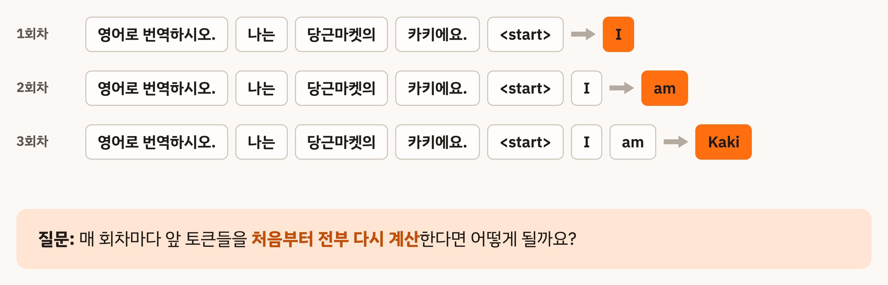

> 실제 토큰은 단어보다 잘게 쪼개지지만 단어 단위로 표시했습니다. Kaki 뒤로 from, Karrot이 이어지지만 여기서는 Kaki까지만 따라갑니다.

## 2. 모델의 동작구조 살펴보기

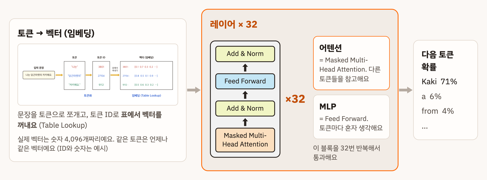

- **토큰 → 벡터 (임베딩)** : 문장을 토큰으로 쪼개고, 토큰 ID로 거대한 표에서 벡터를 꺼냅니다. 계산이 아니라 조회(Table Lookup)라서 같은 토큰은 언제나 같은 벡터입니다. 실제로는 숫자 4,096개짜리 벡터입니다.
- **레이어 × N** : 그 벡터가 레이어를 N번(Llama 3 8B는 32번) 통과합니다. 레이어 하나는 Transformer 논문 그림의 블록과 같습니다.
  - **어텐션** (= Masked Multi-Head Attention) : 다른 토큰들을 참고합니다.
  - **MLP** (= Feed Forward) : 토큰마다 혼자 생각합니다.
- **다음 토큰 확률** : 마지막에 다음 토큰 후보마다 확률이 나오고 (`Kaki 71%`, `a 6%`, `from 4%` ...), 거기서 하나를 고릅니다.

> 레이어 32개, 벡터 숫자 4,096개 같은 값은 Llama 3 8B를 예시로 든 겁니다. 모델마다 다르고(예: Llama 3 70B는 레이어 80개), 이 글에 나오는 숫자는 따로 언급이 없으면 전부 Llama 3 8B 기준입니다.

정리하면 **Transformer는 어텐션과 MLP가 N번 반복되는 구조**일 뿐입니다. (디테일하게 들어가면 끝도 없지만, 일단 이 정도만 이해하고 넘어가셔도 무방합니다.)  
  
그리고 중요한 사실 하나. **토큰끼리 정보를 주고받는 곳은 어텐션뿐입니다.** MLP는 토큰마다 따로 계산합니다. '앞 문맥을 참고한다'는 일은 전부 어텐션에서 일어나고, KV Cache도 바로 이 어텐션에 붙어 있습니다.

## 3. 어텐션

### Attention = 주의, 집중

어텐션은 이름 그대로 **어디에 '집중'할지 정하는 메커니즘**입니다. 무언가를 하나 만들 때마다, 볼 수 있는 것 전체 중에서 지금 필요한 곳을 골라 더 많이 집중합니다.

### 번역에서 시작된 어텐션

어텐션이 처음 나온 건 2014년 번역 모델입니다. 영어 단어를 하나씩 만들어 가는데, 단어 하나를 만들 때마다 한국어 문장 전체를 다시 보고 지금 필요한 단어에 집중합니다.

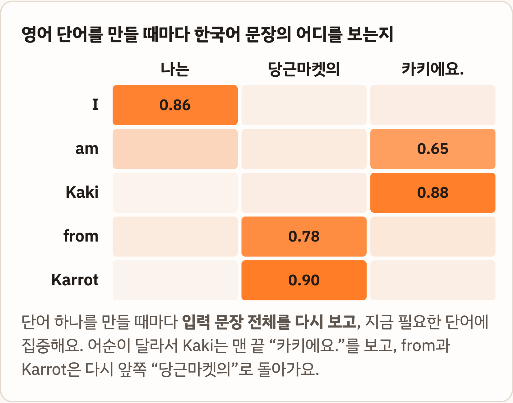

한국어와 영어는 어순이 달라서 집중하는 위치가 이리저리 튑니다. Kaki는 맨 끝 "카키에요."를 보고, from과 Karrot은 다시 앞쪽 "당근마켓의"로 돌아갑니다.

> 한국어 예시 값은 설명용입니다.

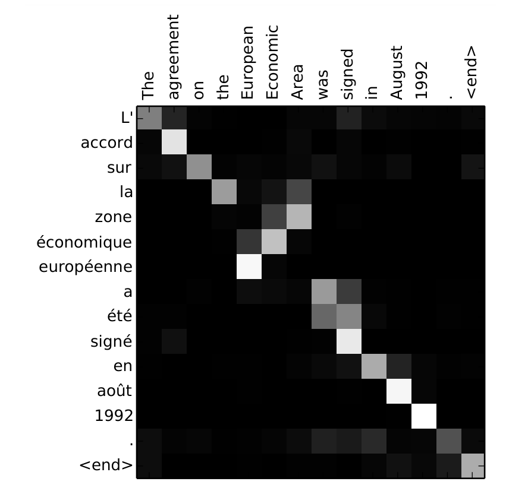

위는 원조 논문의 실제 어텐션 맵(영어 → 프랑스어)입니다. 밝을수록 많이 본 곳입니다. 대부분 대각선이지만 "European Economic Area" → "zone économique européenne"에서 순서가 뒤집혀 그 부분만 대각선이 꺾여 있습니다.

> 출처: Bahdanau et al., *Neural Machine Translation by Jointly Learning to Align and Translate* (2014), Figure 3(a)

### 음성인식: 집중하는 곳이 곡선처럼 이어진다

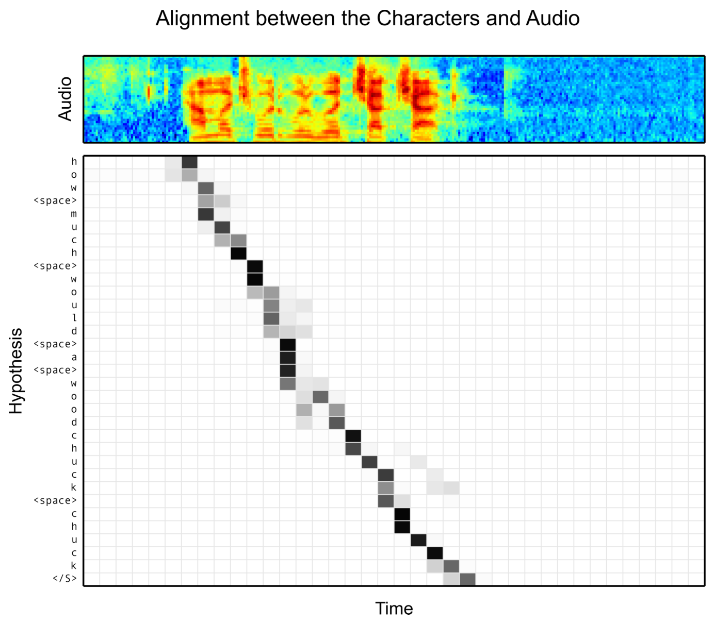

음성인식에서는 어텐션이 하는 일이 더 눈에 잘 보입니다. 위는 음성 신호, 아래 표의 세로는 출력 글자, 가로는 시간입니다. "how much would a woodchuck chuck"을 받아쓰는 장면입니다.

- 글자를 하나 쓸 때마다 음성 전체 중 **지금 발음되는 구간**에 집중합니다.
- 말은 순서대로 이어지니까, 집중하는 위치도 왼쪽 위에서 오른쪽 아래로 곡선처럼 따라 내려갑니다.

**아무도 "이 글자는 이 구간"이라고 알려주지 않았는데도** 어텐션이 학습을 통해서 자연스럽게 본인의 역할을 수행해냅니다.

> 출처: Chan et al., *Listen, Attend and Spell* (2015), Figure 2

### 정리: 보는 대상만 바뀌었을 뿐

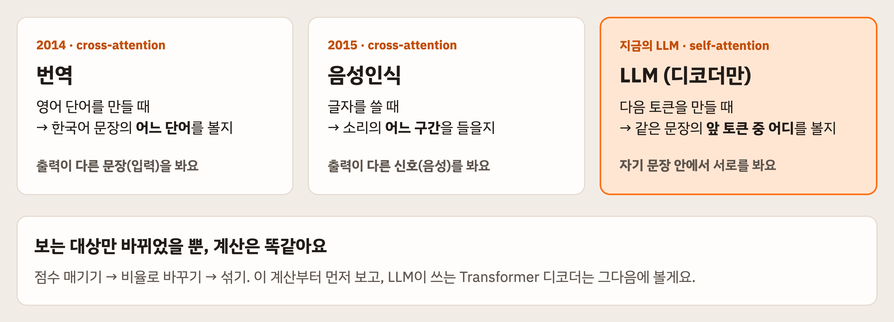

**보는 대상만 바뀌었을 뿐, 계산은 똑같습니다.** 점수 매기기 → 비율로 바꾸기 → 섞기. 이 계산부터 먼저 보고, LLM이 쓰는 Transformer 디코더는 그다음에 보겠습니다.

## 4. 어텐션: 연산

### Seq2seq에서의 Q, K, V

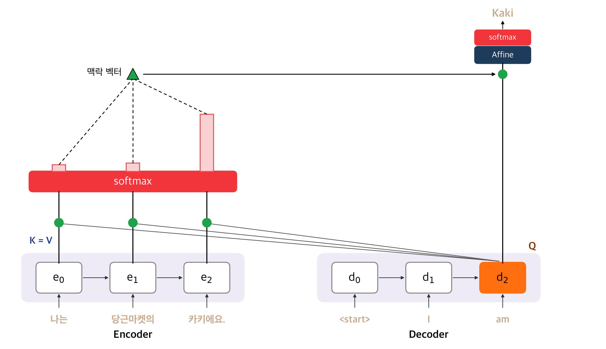

어텐션은 Seq2seq(인코더-디코더) 번역 모델에서 제안됐습니다. 인코더(e)가 원문을 단어별 상태로 만들고, 디코더(d)가 단어를 하나 만들 때마다 인코더 상태 전체에 어텐션합니다.

- **Q (Query)** : 디코더의 현재 상태. am 다음 토큰(Kaki)을 만들 차례인 디코더의 벡터(그림의 d₂)로, `<start>`, I, am까지 읽은 맥락이 담겨 있습니다.
- **K (Key)** : 인코더의 단어별 상태. Q와 점수를 매길 대상입니다.
- **V (Value)** : 인코더의 단어별 상태(K와 같은 재료). 비율대로 섞어서 가져올 내용입니다.

> 처음엔 그냥 디코더 상태, 인코더 상태라고 불렀고, 이걸 Query, Key, Value라는 이름으로 정리한 건 2017년 Transformer 논문입니다.

### 1단계: 내적으로 관련도 점수 매기기

디코더가 "Kaki"를 만들 차례입니다. 디코더의 현재 상태(Q)와 인코더의 단어별 상태(K)를 내적해서 점수를 매깁니다. (벡터는 숫자 4개로 단순화했습니다)

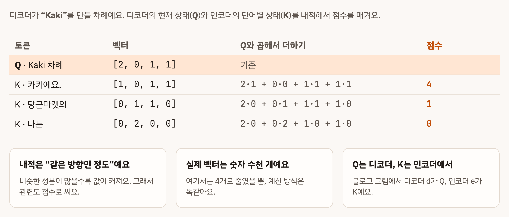

- 내적은 **"같은 방향인 정도"** 입니다. 비슷한 성분이 많을수록 값이 커져서 관련도 점수로 씁니다.
- 실제 벡터는 숫자 수천 개지만 계산 방식은 똑같습니다.

### 2단계: softmax로 비율 만들기

각 점수에 지수함수를 씌우고 전체 합(58.3)으로 나눕니다.

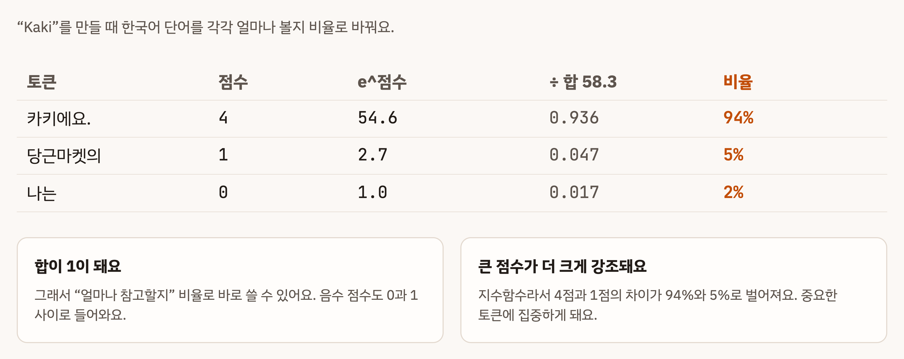

- **합이 1이 됩니다** : 그래서 "얼마나 참고할지" 비율로 바로 쓸 수 있습니다. 음수 점수도 0과 1 사이로 들어옵니다.
- **큰 점수가 더 크게 강조됩니다** : 지수함수라서 4점과 1점의 차이가 94%와 5%로 벌어집니다. 중요한 토큰에 집중하게 되죠. 그래서 이름이 '집중', 어텐션입니다.

### 3단계: 비율대로 섞기 (가중합)

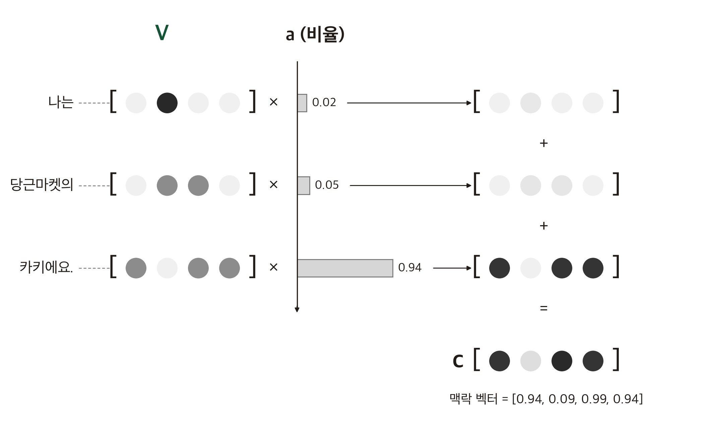

각 토큰의 V에 비율(a)을 곱해 모두 더하면 맥락 벡터(c)가 됩니다. ([어텐션 메커니즘](https://sooftware.github.io/attention/) 글의 그림을 이번 예시로 다시 그렸습니다)

```
  0.94 × [1, 0, 1, 1]
+ 0.05 × [0, 1, 1, 0]
+ 0.02 × [0, 2, 0, 0]
= [0.94, 0.09, 0.99, 0.94]
```

섞은 결과는 거의 "카키에요." 벡터입니다. 디코더는 이 맥락 벡터를 보고 다음 영어 단어 "Kaki"를 고릅니다.

> 계산을 보이려고 K와 V에 같은 숫자를 썼지만, 실제로는 곧 볼 W 때문에 서로 달라집니다.

### 세 단계를 식 하나로

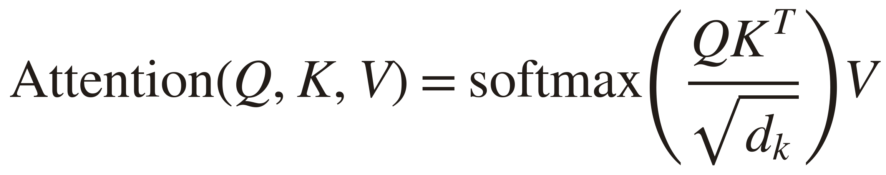

- `QKᵀ` = 1단계 점수
- `softmax` = 2단계 비율
- `× V` = 3단계 섞기

`√dₖ`로 나누는 건 점수가 너무 커지지 않게 하려는 겁니다.

### 실제로는 Q, K, V에 각각 W를 곱해서 넣는다

Q의 재료는 디코더 상태, K·V의 재료는 인코더 상태라고 했는데, 실제로는 이 재료를 그대로 넣지 않고 학습된 행렬 W를 한 번씩 행렬곱해서 넣습니다.

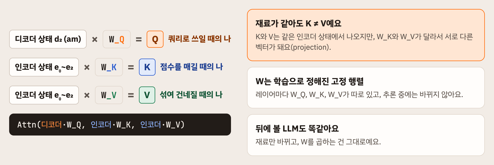

- **재료가 같아도 K ≠ V** : K와 V는 같은 인코더 상태에서 나오지만, W_K와 W_V가 달라서 서로 다른 벡터가 됩니다(projection).
- **W는 학습으로 정해진 고정 행렬** : 레이어마다 W_Q, W_K, W_V가 따로 있고, 추론 중에는 바뀌지 않습니다.
- 뒤에 볼 LLM도 재료만 바뀔 뿐 W를 곱하는 건 똑같습니다.

### W는 학습으로 정해지는 숫자 표

W는 그냥 숫자가 빽빽하게 적힌 표, 행렬입니다. Llama 3 8B 레이어 하나 기준으로 K를 만드는 곱셈을 보면:

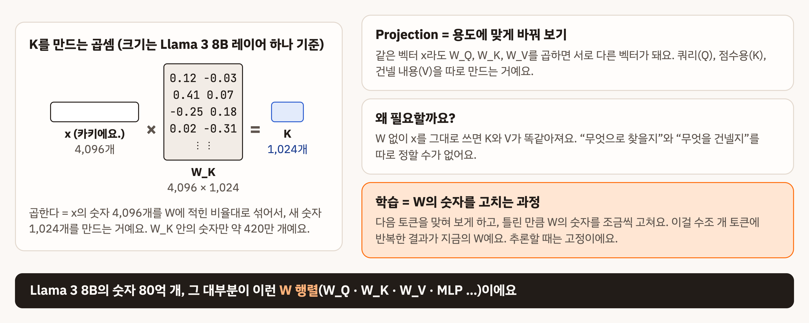

곱한다는 건 **x의 숫자 4,096개를 W에 적힌 비율대로 섞어서 새 숫자 1,024개를 만드는 것**입니다. W_K 안의 숫자만 약 420만 개입니다.

- **왜 필요할까?** W 없이 x를 그대로 쓰면 K와 V가 똑같아집니다. "무엇으로 찾을지"와 "무엇을 건넬지"를 따로 정할 수가 없습니다.
- **학습 = W의 숫자를 고치는 과정** : 다음 토큰을 맞혀 보게 하고, 틀린 만큼 W의 숫자를 조금씩 고칩니다. Llama 3는 이걸 15조 개가 넘는 토큰에 반복했고, 그 결과가 지금의 W입니다.

흔히 말하는 "80억 파라미터"의 대부분이 이런 W 행렬(W_Q · W_K · W_V · MLP ...)입니다.

### K와 V는 쓰이는 곳이 다르다

자주 나오는 질문이 "같은 토큰에서 나오는데 K와 V가 왜 두 개나 필요하냐"입니다. 답은 **쓰이는 곳이 다르다**는 겁니다.

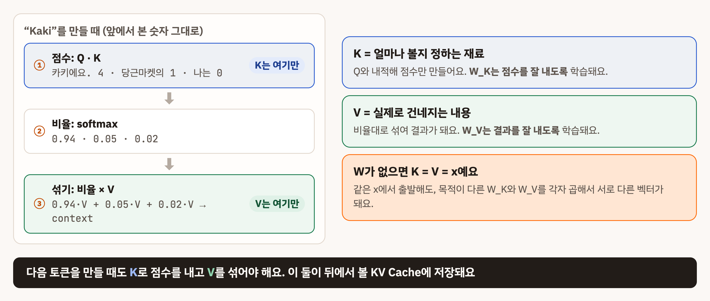

- **K = 점수를 잘 반영하도록** : Q와 내적해 점수만 만듭니다. W_K는 점수를 잘 내도록 학습됩니다.
- **V = 결과에 잘 반영되도록** : 비율대로 섞여 결과가 됩니다. W_V는 결과를 잘 내도록 학습됩니다.

어떤 토큰의 K만 바꾸면 비율이 바뀌고, V만 바꾸면 비율은 그대로인데 섞여 나오는 내용이 바뀝니다.  
  
그리고 이게 KV Cache로 이어집니다. **다음 토큰을 만들 때도 앞 토큰들의 K로 점수를 내고 V를 섞어야 하니까, 둘 다 저장해 둬야 합니다.**

## 5. Transformer: 최신 LLM은 디코더만 쓴다

2017년 *Attention Is All You Need* 는 RNN 없이 어텐션만 쌓아서 번역 모델을 만들었습니다. 원래는 원문을 읽는 **인코더**와 글을 한 토큰씩 쓰는 **디코더**가 있는 구조였는데, 지금의 GPT, Llama 같은 LLM은 **디코더만 쌓은 구조**입니다.  
  
인코더가 없으니 어텐션이 볼 곳이 달라집니다.

### 참고할 건 지금까지의 글뿐

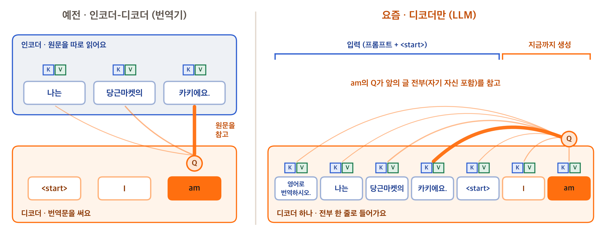

- **예전 인코더-디코더** : 인코더가 원문을 따로 읽어 K, V를 만들고, 디코더(am)에서 나온 Q가 원문을 참고합니다.
- **요즘 디코더만** : 프롬프트, `<start>`, 지금까지 생성한 토큰이 전부 **한 줄**로 들어갑니다. 참고할 수 있는 게 이 한 줄밖에 없으니, Q, K, V가 전부 같은 줄에서 나옵니다. → **이게 Self-Attention입니다.**

### 목적은 같고, 정보가 있는 곳만 다르다

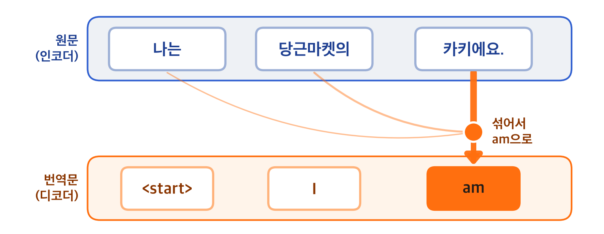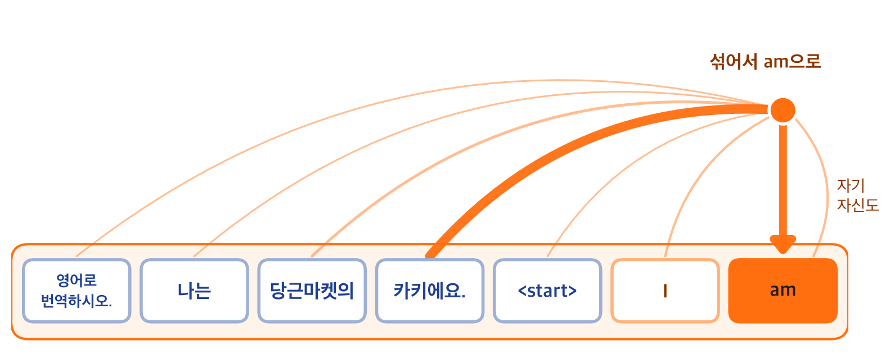

어텐션을 하는 이유는 똑같습니다. 다음 단어(Kaki)를 만들 조건(context)을 모으려고요.

| | 필요한 정보 | 그래서 |
| --- | --- | --- |
| Seq2seq 번역기 | 원문 (인코더 출력) | 원문을 봄 → Cross-Attention |
| LLM (디코더만) | 지금까지 나온 토큰 (am 자신 포함) | 자기 문장을 봄 → Self-Attention |

두 경우 모두 "카키에요."에서 오는 선이 제일 굵습니다. 새로운 기술이라기보다, **정보가 자기 문장 안에만 있으니 거기에 어텐션해서 "Self"** 라는 이름이 붙은 겁니다.

### 자기 문장을 보는 게 왜 필요할까? 뜻은 주변이 정한다

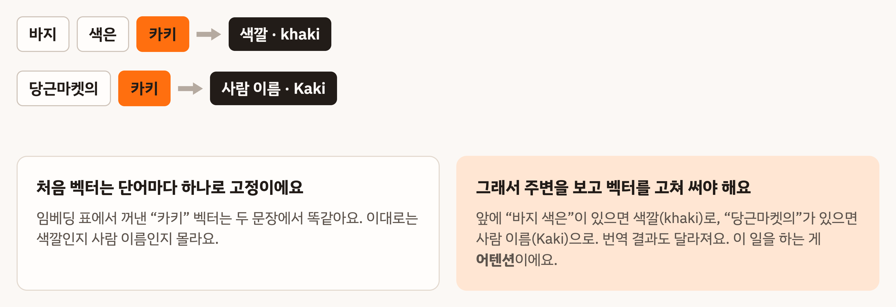

임베딩 표에서 꺼낸 "카키" 벡터는 두 문장에서 똑같습니다. 이대로는 색깔인지 사람 이름인지 모릅니다. 그래서 **주변을 보고 벡터를 고쳐 써야 하고**, 이 일을 하는 게 어텐션입니다.

### Q는 토큰 1개, K·V는 지금까지 전부

헷갈리기 쉬운 부분이라 한 번 정리하고 가겠습니다. am 다음 토큰을 만드는 회차를 보면:

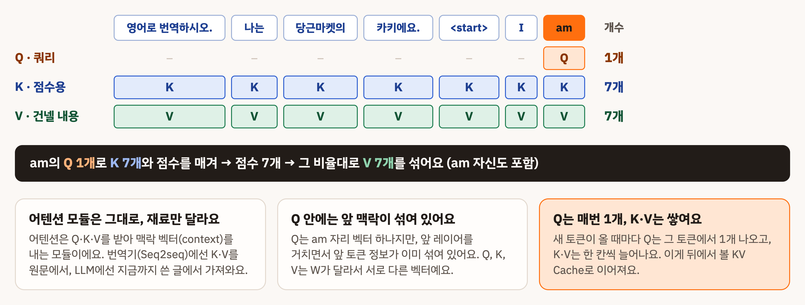

am의 Q 1개로 K 7개와 점수를 매기고, 그 비율대로 V 7개를 섞습니다(am 자신도 포함).

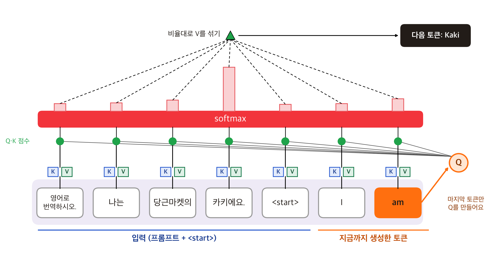

- **어텐션 모듈은 그대로, 재료만 다르다** : 번역기에선 K·V를 원문에서, LLM에선 지금까지 쓴 글에서 가져옵니다.
- **Q 안에는 앞 맥락이 섞여 있다** : Q는 am 자리 벡터 하나지만, 앞 레이어를 거치면서 앞 토큰 정보가 이미 섞여 있습니다.
- **Q는 매번 1개, K·V는 쌓인다** : 새 토큰이 올 때마다 Q는 그 토큰에서 1개 나오고, K·V는 한 칸씩 늘어납니다.

### 코드로 보면 모듈 하나, 넣는 재료만 다르다

```python
class Attention(nn.Module):
    def __init__(self, d):
        super().__init__()
        self.w_q = nn.Linear(d, d, bias=False)  # 학습으로 정해진 가중치
        self.w_k = nn.Linear(d, d, bias=False)  # (추론 땐 고정)
        self.w_v = nn.Linear(d, d, bias=False)

    def forward(self, q, k, v):        # 벡터 1개, (n, d)
        q = self.w_q(q)                # Q: 1개
        k = self.w_k(k)                # K: n개
        v = self.w_v(v)                # V: n개
        score = k @ q / q.shape[-1] ** 0.5     # ① 내적 → 점수 n개
        weight = torch.softmax(score, dim=-1)  # ② softmax → 비율
        return weight @ v                      # ③ 가중합 → context vector

attn = Attention(d=4096)

# Cross (번역기): K·V 재료 = 원문(인코더 출력)
context = attn(dec_state, enc_out, enc_out)

# Self (LLM): K·V 재료 = 지금까지 쓴 글 x (am 포함 7개)
context = attn(x[-1], x, x)
```

forward 안의 `k`, `v` 두 줄을 기억해 주세요. 이게 바로 KV Cache가 저장하는 값입니다.

> 실제 모델은 이걸 레이어마다, 헤드마다 하고, Llama 3 8B는 K, V 크기가 Q보다 작은 GQA를 쓰지만 원리는 같습니다.

## 6. KV Cache

### 캐시가 없으면: 매번 전부 다시 계산

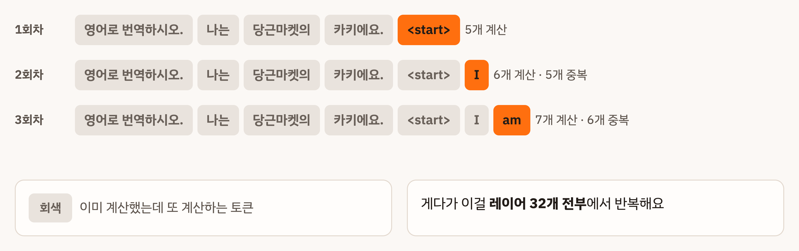

회차가 늘수록 중복이 계속 늘어납니다. 게다가 이걸 **레이어 32개 전부에서** 반복합니다.

### 앞 토큰의 K·V는 그대로다

그럼 다시 계산한 결과가 지난번과 달라질까요? 아닙니다.

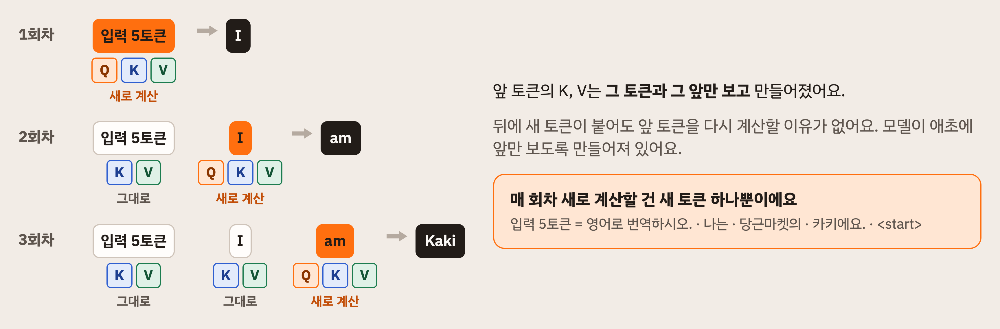

앞 토큰의 K, V는 **그 토큰과 그 앞만 보고** 만들어졌습니다. 뒤에 새 토큰이 붙어도 다시 계산할 이유가 없습니다. 모델이 애초에 앞만 보도록 만들어져 있거든요. 그러니까 **매 회차 새로 계산할 건 새 토큰 하나뿐**입니다.  
  
정리하면, **바뀌지 않는 값을 매번 다시 계산하고 있었던 겁니다.** 백엔드 개발자라면 바로 떠오르죠. 캐시하면 되잖아요? memoization이랑 똑같습니다. 그게 KV Cache입니다.

### 캐시가 있으면: 새 토큰 하나만 계산

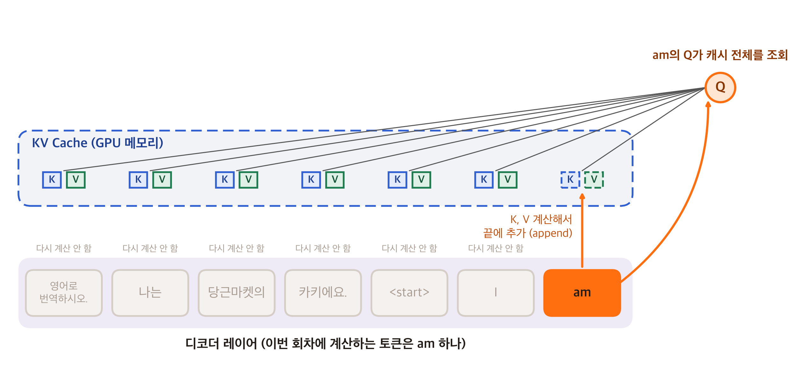

1. 새 토큰 "am" 하나만 Q, K, V를 계산합니다.
2. K, V는 캐시 끝에 append합니다.
3. Q로 캐시 전체를 조회해서 어텐션을 계산합니다.
4. 레이어 32개 모두 같은 방식입니다.

리스트에 append하는 것과 거의 같은 구조입니다.

### 그럼 Q는 왜 저장 안 해요?

꼭 나오는 질문입니다.

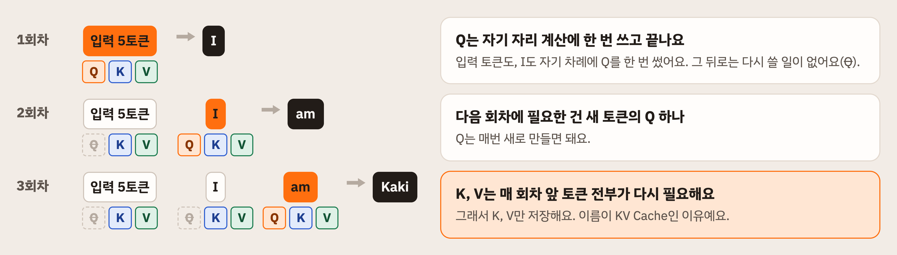

- **Q는 자기 자리 계산에 한 번 쓰고 끝납니다.** 입력 토큰도, I도 자기 차례에 Q를 한 번 썼고, 그 뒤로는 다시 쓸 일이 없습니다.
- **다음 회차에 필요한 건 새 토큰의 Q 하나**라서 매번 새로 만들면 됩니다.
- **K, V는 매 회차 앞 토큰 전부가 다시 필요합니다.**

캐시는 다시 읽히는 것만 저장하니까, K, V만 저장합니다. 이름이 **KV Cache**인 이유입니다.

### 토큰이 K, V를 "들고 있다"는 건

"카키에요."가 레이어에 들어오면 숫자 4,096개짜리 벡터 x입니다. 여기에 W_K를 곱하면 1,024개짜리 K, W_V를 곱하면 V가 나옵니다. 들고 있는 건 이 **결과 벡터**입니다.

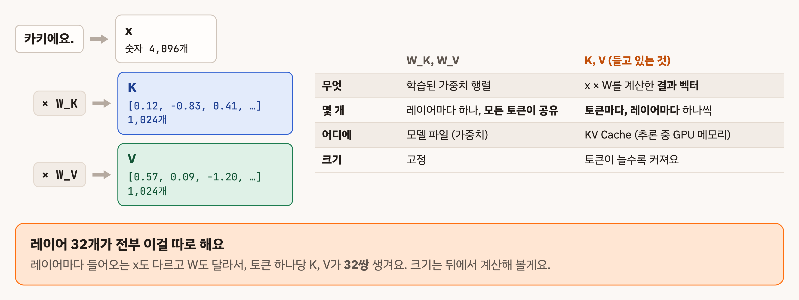

> Llama 3 8B 기준입니다. K, V가 1,024개인 건 KV 헤드 8개 × 128이라서입니다. (헤드: 어텐션을 여러 묶음으로 나눠 동시에 하는 단위)

### 캐시는 레이어마다 따로 쌓인다

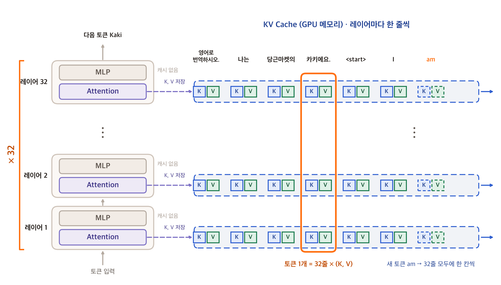

어텐션이 있는 레이어마다 캐시가 한 줄씩 있습니다. 레이어마다 들어오는 x도 다르고 W도 다르니까요. MLP는 다른 토큰을 안 보니까 캐시가 없습니다. 토큰이 하나 생기면 32줄 모두에 K, V가 한 칸씩 늘어납니다.

```
# 실제 메모리 모양 (Llama 3 8B)
kv_cache[레이어 32][K·V 2][헤드 8][토큰 수 →][128]
```

토큰 수 축만 계속 늘어납니다.

### 얼마나 줄어들까?

프롬프트 1,000토큰에 답변 100토큰을 만드는 경우:

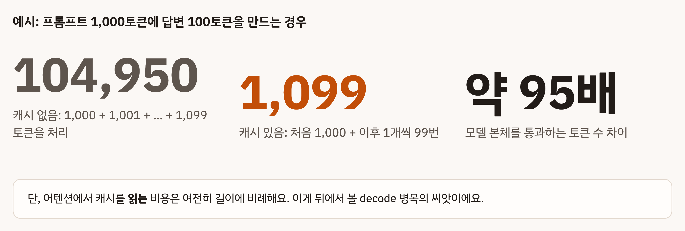

단, 어텐션에서 **캐시를 읽는 비용은 여전히 길이에 비례**합니다. 이게 뒤에서 볼 decode 병목의 씨앗입니다.

## 7. Prefill과 Decode

### 추론은 두 단계로 나뉜다

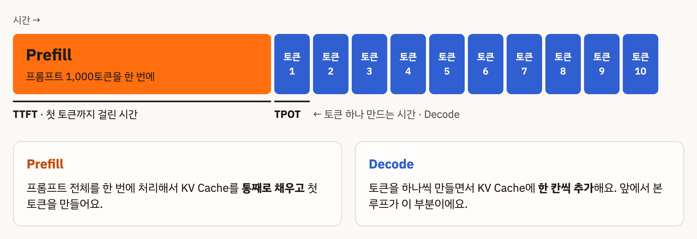

- **Prefill** : 프롬프트 전체를 한 번에 처리해서 KV Cache를 통째로 채우고 첫 토큰을 만듭니다. 여기까지 걸린 시간이 TTFT(Time To First Token)입니다.
- **Decode** : 토큰을 하나씩 만들면서 KV Cache에 한 칸씩 추가합니다. 앞에서 본 루프가 이 부분이고, 토큰 하나에 걸리는 시간이 TPOT입니다.

서빙 대시보드에서 이 두 지표를 따로 보는 이유가 여기 있습니다.

### Prefill: 프롬프트를 통째로 한 번에 (현상 1의 답)

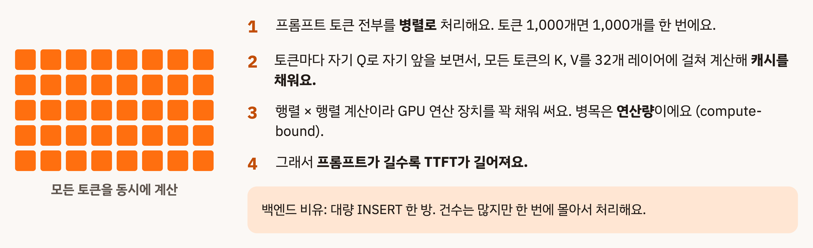

1. 프롬프트 토큰은 이미 다 주어져 있으니 전부 병렬로 처리합니다. 1,000개면 1,000개를 한 번에요.
2. 토큰마다 자기 Q로 자기 앞을 보면서, 모든 토큰의 K, V를 32개 레이어에 걸쳐 계산해 캐시를 채웁니다.
3. 행렬 × 행렬 계산이라 GPU 연산 장치를 꽉 채워 씁니다. **병목은 연산량**입니다 (compute-bound).
4. 그래서 프롬프트가 길수록 TTFT가 길어집니다.

백엔드로 비유하면 **대량 INSERT 한 방**입니다. RAG로 문서를 잔뜩 붙이면 첫 응답이 느려지는 이유가 이겁니다.

### 앞부분이 같으면 K, V를 다시 쓴다 (현상 2의 답)

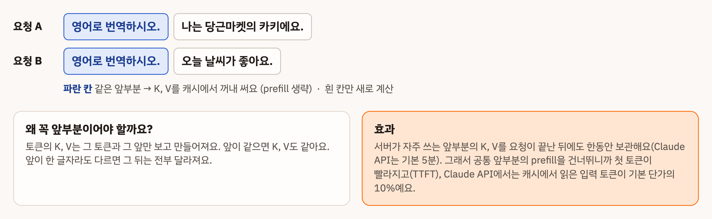

**왜 꼭 앞부분이어야 할까?** 토큰의 K, V는 그 토큰과 그 앞만 보고 만들어집니다. 앞이 같으면 K, V도 같습니다. 반대로 앞이 한 글자라도 다르면 그 뒤는 전부 달라집니다.  
  
서버는 자주 쓰는 앞부분의 K, V를 요청이 끝난 뒤에도 한동안 보관합니다(Claude API는 기본 5분). 공통 앞부분의 prefill을 건너뛰니까 첫 토큰이 빨라지고, Claude API에서는 캐시에서 읽은 입력 토큰이 기본 단가의 10%입니다.

> 실제 Claude API는 캐시할 지점을 `cache_control`로 지정하고, 일정 길이(모델에 따라 1,024토큰 등) 이상이어야 캐시됩니다. 캐시에 처음 쓸 때는 기본 단가의 1.25배입니다.

### Decode: 한 번에 한 토큰씩

토큰 1개를 만들려고 **모델 가중치 전체(16GB)** 와 **이 요청의 KV Cache 전체**를 매번 전부 읽습니다.  
  
행렬 × 벡터라 연산은 금방 끝나지만, 매 스텝 메모리에서 가중치와 캐시를 다 읽어와야 합니다. **병목은 메모리 대역폭**입니다 (memory-bound).

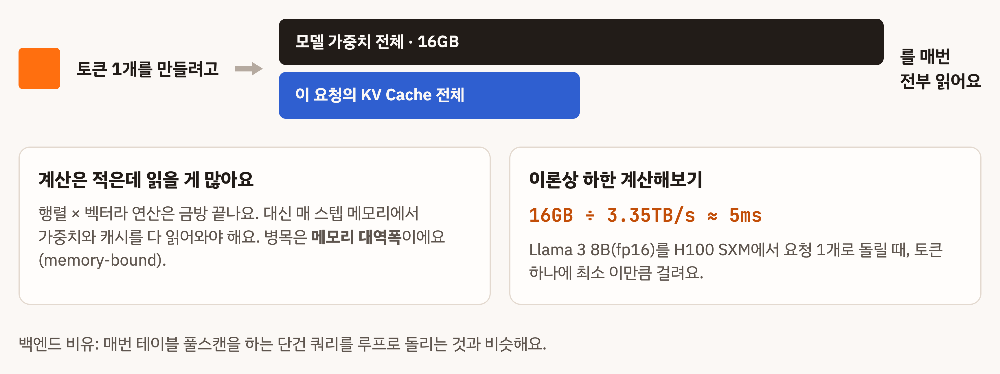

백엔드로 비유하면 **매번 테이블 풀스캔을 하는 단건 쿼리를 루프로 돌리는 것**과 비슷합니다.

### 배칭과 KV Cache는 함께 쓴다

"KV Cache를 쓰면 배칭은 안 쓰냐"는 질문도 자주 나오는데, 둘은 같이 씁니다.

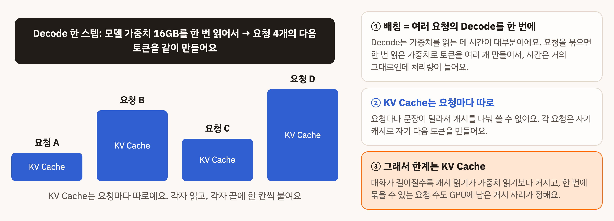

1. **배칭 = 여러 요청의 Decode를 한 번에** : Decode는 가중치를 읽는 데 시간이 대부분이라, 요청을 묶으면 시간은 거의 그대로인데 처리량이 늘어납니다.
2. **KV Cache는 요청마다 따로** : 요청마다 문장이 달라서 캐시를 나눠 쓸 수 없습니다.
3. **그래서 한계는 KV Cache** : 대화가 길어질수록 캐시 읽기가 가중치 읽기보다 커지고, 한 번에 묶을 수 있는 요청 수도 GPU에 남은 캐시 자리가 정합니다.

## 8. 메모리 비용

### KV Cache는 얼마나 클까?

```
토큰 1개 = 2 (K, V) × 32 (레이어) × 8 (KV 헤드) × 128 × 2 (바이트) = 128KB
```

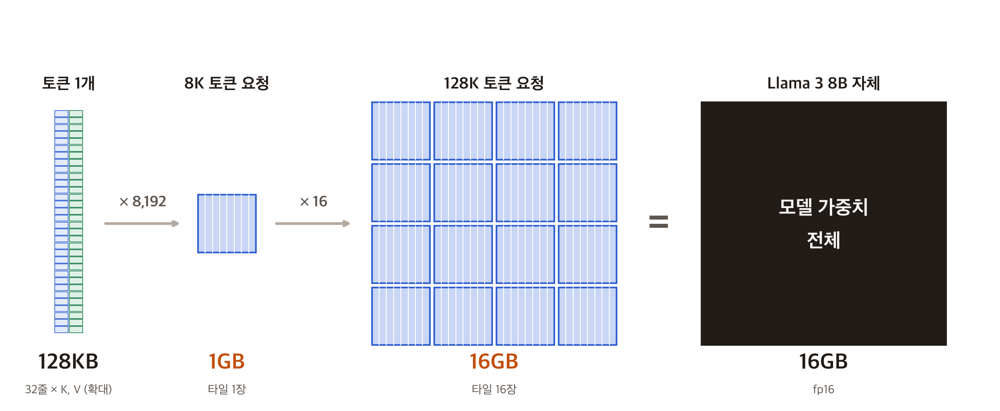

별것 아닌 것 같지만 쌓이면 다릅니다. 8K 토큰 요청 하나면 1GB, 128K 토큰짜리 긴 요청이면 16GB입니다. **Llama 3 8B 모델 가중치 전체가 fp16으로 16GB**니까, 긴 요청 하나의 캐시가 모델 하나만 한 겁니다. 그리고 동시에 요청이 여러 개 들어오면 요청마다 따로 생깁니다.

### 모델이 크면 캐시도 클까? 구조가 정한다

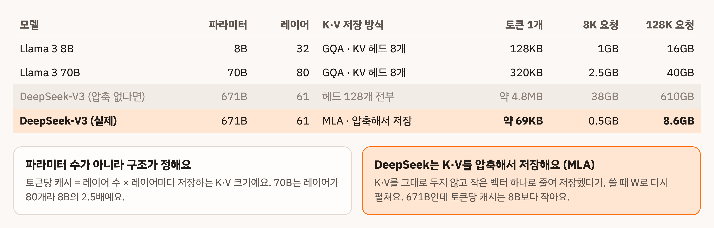

- **파라미터 수가 아니라 구조가 정합니다.** 토큰당 캐시 = 레이어 수 × 레이어마다 저장하는 K·V 크기입니다. 70B는 레이어가 80개라 8B의 2.5배입니다.
- **DeepSeek는 K·V를 압축해서 저장합니다 (MLA).** K·V를 그대로 두지 않고 작은 벡터 하나로 줄여 저장했다가, 쓸 때 W로 다시 펼칩니다. 671B인데 토큰당 캐시는 8B보다 작습니다.

> bf16 기준. DeepSeek-V3는 레이어당 압축 벡터 512 + 위치용 64 = 576개, 압축이 없다면 헤드 128개 × (K 192 + V 128)로 계산했습니다.

### GPU 메모리가 동시 요청 수를 정한다

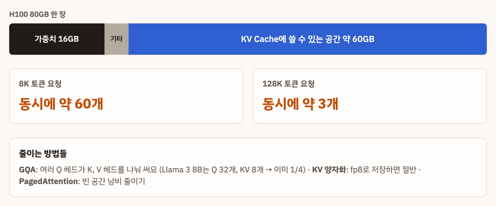

그래서 LLM 서빙에서 동시 처리량은 연산이 아니라 **KV Cache 메모리**가 정합니다. 이걸 줄이려고 나온 기법들입니다.

- **GQA** : 여러 Q 헤드가 K, V 헤드를 나눠 씁니다. (Llama 3 8B는 Q 32개, KV 8개 → 이미 1/4)
- **KV 양자화** : fp8로 저장하면 절반
- **PagedAttention** : 빈 공간 낭비 줄이기

### 예전 서빙: 최대 길이만큼 미리 잡아서 낭비

예전 서빙 시스템은 요청이 들어오면 답이 얼마나 길어질지 모르니까, **최대 길이만큼 연속된 메모리를 통째로 미리 잡아** 뒀습니다. 크기를 모르니 일단 최대 크기로 배열을 malloc해 두는 셈입니다.

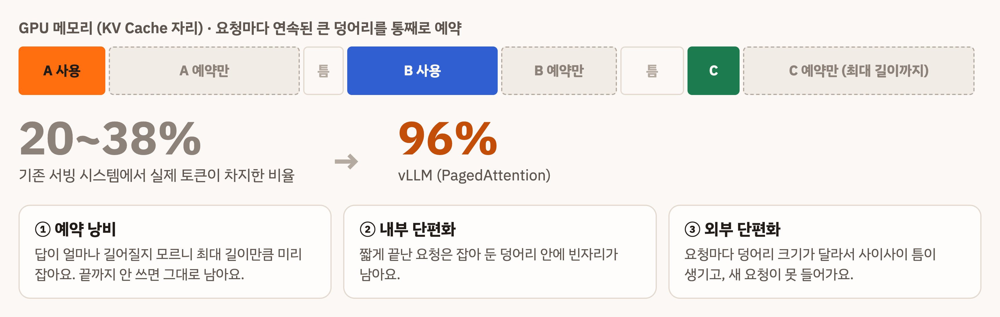

1. **예약 낭비** : 최대 길이만큼 미리 잡았는데 끝까지 안 쓰면 그대로 남습니다.
2. **내부 단편화** : 짧게 끝난 요청은 잡아 둔 덩어리 안에 빈자리가 남습니다.
3. **외부 단편화** : 요청마다 덩어리 크기가 달라서 사이사이 틈이 생기고, 새 요청이 못 들어갑니다.

vLLM 논문이 측정해 보니 기존 시스템에서 KV Cache 메모리 중 실제 토큰이 차지한 비율은 **20~38%** 밖에 안 됐습니다. vLLM은 이걸 **96%** 까지 올렸습니다.

### PagedAttention: KV Cache를 OS 페이지처럼

vLLM의 해법은 OS의 가상 메모리에서 가져왔습니다.

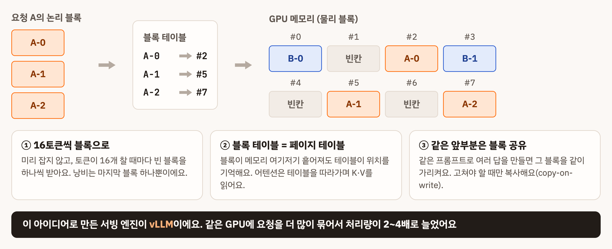

1. **16토큰씩 블록으로** : 미리 잡지 않고, 토큰이 16개 찰 때마다 빈 블록을 하나씩 받습니다. 낭비는 마지막 블록 하나뿐입니다.
2. **블록 테이블 = 페이지 테이블** : 블록이 메모리 여기저기 흩어져도 테이블이 위치를 기억합니다. 어텐션은 테이블을 따라가며 K·V를 읽습니다.
3. **같은 앞부분은 블록 공유** : 같은 프롬프트로 여러 답을 만들면 그 블록을 같이 가리키고, 고쳐야 할 때만 복사합니다(copy-on-write).

이 아이디어로 만든 서빙 엔진이 **vLLM**입니다. 같은 GPU에 요청을 더 많이 묶을 수 있게 되면서 당시 다른 서빙 시스템보다 처리량이 2~4배 높았고, 지금은 이 방식이 서빙 엔진의 사실상 표준이 됐습니다.

> Kwon et al. (UC Berkeley), *Efficient Memory Management for Large Language Model Serving with PagedAttention*, SOSP 2023

## 9. 처음 본 세 현상, 이제 답할 수 있다

**현상 1. 첫 글자만 유독 느리다**  
첫 토큰은 프롬프트 전체를 레이어 32개에 통과시켜야 나옵니다(Prefill). 그다음부터는 KV Cache 덕분에 새 토큰 하나만 계산해서 술술 나옵니다.  
  
**현상 2. 앞부분이 같으면 싸고 빨라진다**  
토큰의 K, V는 그 토큰과 그 앞만 보고 만들어집니다. 앞이 같으면 K, V도 같으니까, 서버가 보관해 둔 K, V를 꺼내 쓰고 그 부분의 Prefill을 건너뜁니다.  
  
**현상 3. 대화가 길수록 느리고 비싸다**  
Decode는 토큰 하나마다 이 요청의 캐시 전체를 읽습니다. 캐시는 토큰 하나에 128KB씩 쌓여서, GPU 한 장이 동시에 받을 수 있는 요청 수도 줄어듭니다.

## 정리

1. LLM은 토큰을 하나씩 만드는 루프다.
2. 어텐션은 점수 → 비율 → 섞기로 "어디에 집중할지" 정한다.
3. LLM은 같은 줄 안에서 어텐션한다. Q는 지금 토큰의 쿼리, K는 얼마나 볼지 정하는 재료, V는 실제로 건네지는 내용.
4. 앞 토큰의 K, V는 바뀌지 않는데 매 회차 다시 필요하고, Q는 한 번 쓰고 끝난다. 그래서 K, V만 저장한다 = **KV Cache**
5. Prefill은 한 번에 채우고(연산이 병목), Decode는 한 칸씩 늘리며 캐시 전체를 읽는다(메모리가 병목).
6. 비용은 GPU 메모리. 토큰 하나에 128KB(Llama 3 8B)라서, 길수록 동시에 받을 요청 수가 줄어든다.

## 부록: MLP는 왜 캐시가 없을까?

### 어텐션은 주고받고, MLP는 각자 처리한다

어텐션은 am 자리의 출력을 만들 때 7개 토큰 전부의 K·V를 섞어 옵니다. MLP는 am 벡터 하나만 넣습니다. 그래서 아래 두 코드의 결과가 같습니다.

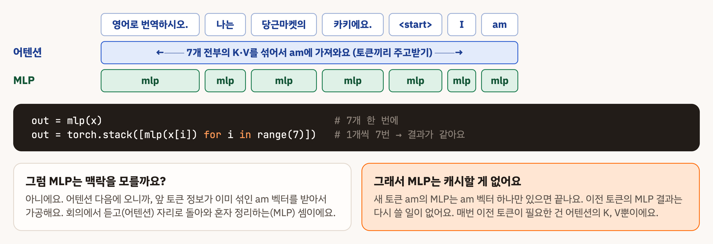

- **그럼 MLP는 맥락을 모를까?** 아닙니다. 어텐션 다음에 오니까, 앞 토큰 정보가 이미 섞인 am 벡터를 받아서 가공합니다. 회의에서 듣고(어텐션) 자리로 돌아와 혼자 정리하는(MLP) 셈입니다.
- **그래서 MLP는 캐시할 게 없습니다.** 이전 토큰의 MLP 결과는 다시 쓸 일이 없습니다. 매번 이전 토큰이 필요한 건 어텐션의 K, V뿐입니다.

### MLP가 없으면 토큰들이 다 비슷해진다

어텐션 출력은 V들의 가중평균이라, 섞기만 반복하면 차이가 지워집니다. 물감 일곱 개가 매번 서로를 조금씩 섞어 오면 결국 전부 같은 회갈색이 되는 것처럼요. 순수 어텐션만 쌓으면 층이 깊어질수록 이중 지수적으로 한 벡터로 무너진다는 연구도 있습니다(rank collapse).  
  
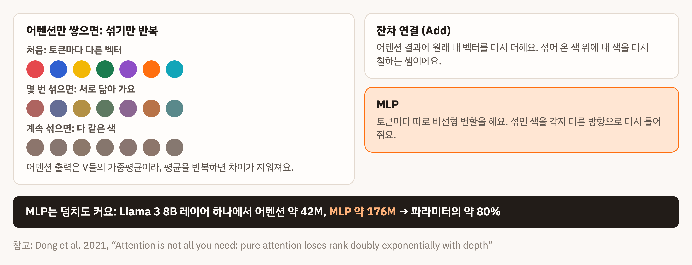

실제 Transformer가 무너지지 않는 건 두 장치 덕분입니다.

- **잔차 연결 (Add)** : 어텐션 결과에 원래 내 벡터를 다시 더합니다. 섞어 온 색 위에 내 색을 다시 칠하는 셈입니다.
- **MLP** : 토큰마다 따로 비선형 변환을 해서 섞인 색을 각자 다른 방향으로 다시 틀어 줍니다.

MLP는 덩치도 큽니다. Llama 3 8B 레이어 하나에서 어텐션이 약 42M, MLP가 약 176M으로 **파라미터의 약 80%** 가 MLP입니다.

> Dong et al. 2021, *Attention is not all you need: pure attention loses rank doubly exponentially with depth*

### "MLP = 지식 저장소", 지금은 이렇게 본다

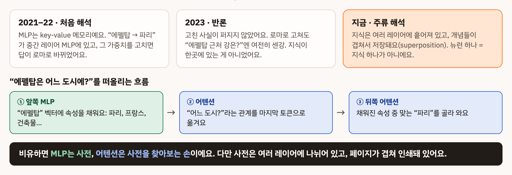

처음엔 MLP를 key-value 메모리처럼 보고 "에펠탑 → 파리" 같은 사실이 특정 레이어에 있다고 해석했지만, 고친 사실이 주변으로 퍼지지 않는다는 반론이 나왔습니다. 지금은 지식이 여러 레이어에 흩어져 겹쳐 저장된다(superposition)고 보는 게 주류입니다.

비유하면 MLP는 사전, 어텐션은 사전을 찾아보는 손입니다. 다만 사전은 여러 레이어에 나뉘어 있고, 페이지가 겹쳐 인쇄돼 있습니다. 이 분야는 아직 연구가 활발해서 해석이 계속 바뀌고 있습니다.

## 더 읽어볼 자료

- [어텐션 메커니즘 · Sooftware 블로그](https://sooftware.github.io/attention/)
- [The Illustrated Transformer · Jay Alammar](https://jalammar.github.io/illustrated-transformer/)
- [Attention Is All You Need (2017)](https://arxiv.org/abs/1706.03762)
- [Efficient Memory Management for LLM Serving with PagedAttention (2023)](https://arxiv.org/abs/2309.06180)
